

# Guardians of Gold

**v1.3-BETA** &nbsp;·&nbsp; RPG de ação em pixel-art, no browser

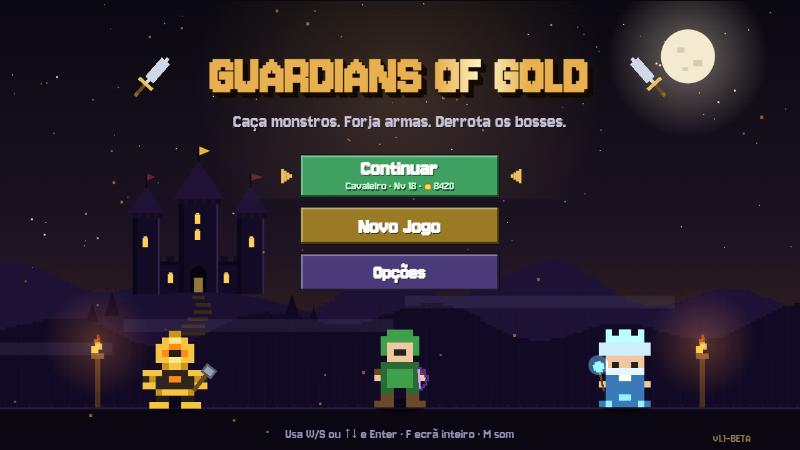

Escolhe um herói, farma ondas infinitas, enfrenta raids muito difíceis, equipa e encanta o teu guerreiro e sobe de nível. Tudo num único ficheiro HTML, sem instalação.

## Jogar

- **Localmente:** descarrega o repositório e abre o `index.html` no Chrome, Edge ou Firefox.
- **Online:** se o GitHub Pages estiver ativo, em <https://arroznatwitch.github.io/guardian-of-gold/>.
- **Wiki com pesquisa:** abre o `wiki.html` (ou <https://arroznatwitch.github.io/guardian-of-gold/wiki.html>).
- O progresso fica guardado **na tua conta online** (nick + palavra-passe). Se o servidor não estiver configurado, fica no teu browser.
- Português (Portugal) e English (UK), em **Opções**.

> Versão beta: podem existir bugs e o equilíbrio ainda vai mudar. Feedback bem-vindo nas *Issues*.

## Como jogar

| Ação | Tecla |
|---|---|
| Mover | `W` `A` `S` `D` ou setas |
| Atacar | rato (esquerdo) ou `Espaço` |
| Especial da classe | `Q` ou botão direito |
| Habilidade da arma | `E` |
| Esquiva | `Shift` |
| Auto-ataque | `T` |
| Velocidade x2 | `G` |
| Pausa | `Esc` |
| Som / Ecrã inteiro | `M` / `F` |

Todas as teclas podem ser mudadas em **Opções > Teclas**.

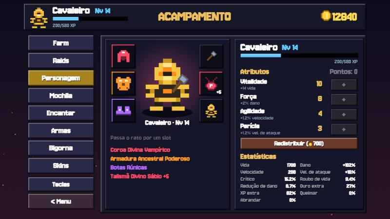 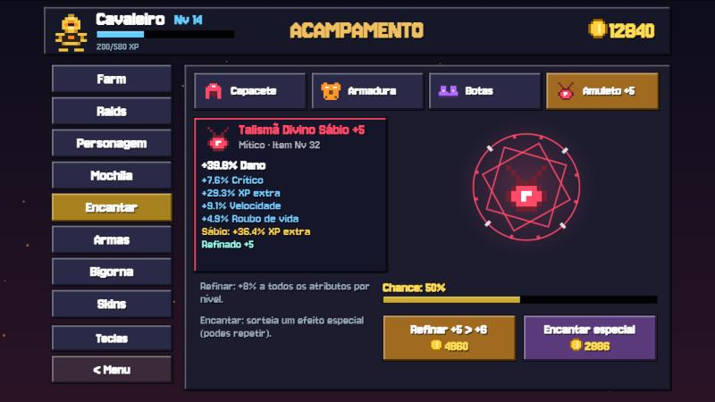

---

# Wiki

Índice: [Classes](#classes) · [Armas](#armas) · [Equipamento](#equipamento) · [Encantamentos](#encantamentos-e-bigorna) · [Fusão](#fusão) · [Progressão](#progressão) · [Farm e Raids](#farm-e-raids) · [Mapas](#mapas) · [Inimigos e bosses](#inimigos-e-bosses) · [Skins](#skins) · [Recompensas](#recompensas-e-diamantes)

## Classes

A classe é escolhida ao criar o personagem e **não pode ser trocada** (só apagando o progresso).

| | Classe | Vida | Veloc. | Especial (`Q`) | Estilo |
|---|---|---|---|---|---|
| 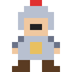 | **Cavaleiro** | 140 | 165 | **Redemoinho**: Gira a lâmina e fere tudo à volta. | Tanque corpo-a-corpo. Muita vida, golpes pesados e 15% menos dano recebido. |
|  | **Arqueiro** | 95 | 195 | **Chuva de Flechas**: Dispara 14 flechas em todas as direções. | Ataca de longe. Rápido mas frágil. |
|  | **Mago** | 80 | 175 | **Nova Gélida**: Explosão de gelo que fere e atrasa todos. | Magia à distância com efeitos especiais. |

## Armas

Cada classe tem 5 armas, compradas com ouro. As mais fortes só se desbloqueiam com **nível** e depois de vencer certas **raids**. Cada arma tem uma **habilidade própria** na tecla `E` e pode ser melhorada na **Bigorna** até +12.

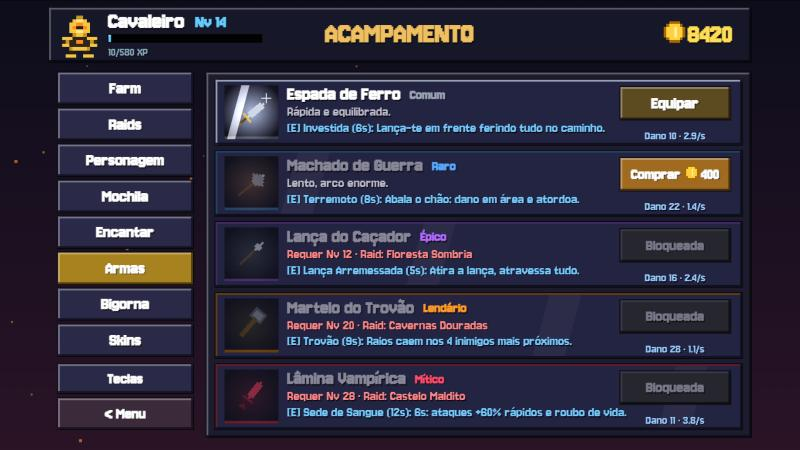

### Cavaleiro

| | Arma | Dano | Cadência | Habilidade (`E`) | Preço | Requisitos |
|---|---|---|---|---|---|---|
| 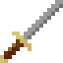 | **Espada de Ferro** Rápida e equilibrada. | 10 | 2.9/s | **Investida** (6s): Lança-te em frente ferindo tudo no caminho. | inicial | — |
| 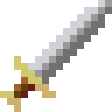 | **Machado de Guerra** Lento, arco enorme. | 34 | 1.4/s | **Terremoto** (8s): Abala o chão: dano em área e atordoa. | ¢400 | Nv 6 |
| 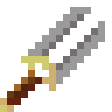 | **Lança do Caçador** Alcance muito longo. | 20 | 2.4/s | **Lança Arremessada** (5s): Atira a lança, atravessa tudo. | ¢1800 | Nv 12 + raid *Floresta Sombria* |
| 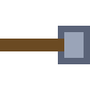 | **Martelo do Trovão** Pesadíssimo, grande recuo. | 49 | 1.1/s | **Trovão** (9s): Raios caem nos 4 inimigos mais próximos. | ¢7000 | Nv 20 + raid *Cavernas Douradas* |
| 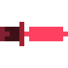 | **Lâmina Vampírica** Muito rápida, rouba vida. | 34 | 3.8/s | **Sede de Sangue** (12s): 6s: ataques +60% rápidos e roubo de vida. | ¢20000 | Nv 28 + raid *Castelo Maldito* |

### Arqueiro

| | Arma | Dano | Cadência | Habilidade (`E`) | Preço | Requisitos |
|---|---|---|---|---|---|---|
| 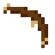 | **Arco Curto** Flecha rápida e certeira. | 10 | 2.6/s | **Salva Rápida** (6s): 7 flechas em rápida sequência. | inicial | — |
| 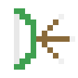 | **Arco Triplo** 3 flechas em leque. | 9 | 1.8/s | **Leque** (7s): 11 flechas num leque gigante. | ¢400 | Nv 6 |
| 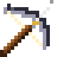 | **Besta Pesada** Lenta, atravessa inimigos. | 36 | 1.1/s | **Virote Perfurante** (7s): Virote enorme que atravessa tudo. | ¢1800 | Nv 12 + raid *Floresta Sombria* |
| 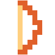 | **Arco Ígneo** Flechas que queimam. | 30 | 2.4/s | **Flecha Explosiva** (8s): Explode em área e incendeia. | ¢7000 | Nv 20 + raid *Cavernas Douradas* |
| 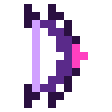 | **Arco Sombrio** Duas flechas, cadência alta. | 14 | 3.3/s | **Armadilha** (9s): Coloca uma armadilha no cursor. | ¢20000 | Nv 28 + raid *Castelo Maldito* |

### Mago

| | Arma | Dano | Cadência | Habilidade (`E`) | Preço | Requisitos |
|---|---|---|---|---|---|---|
| 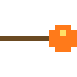 | **Cajado de Fogo** Bola de fogo explosiva que deixa chamas no chão. | 18 | 1.7/s | **Meteoro** (8s): Chama um meteoro que incendeia o chão. | inicial | — |
| 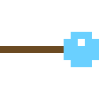 | **Cajado de Gelo** Congela e deixa um rasto gelado. | 21 | 2.5/s | **Prisão de Gelo** (9s): Prende tudo em cristais de gelo. | ¢400 | Nv 6 |
| 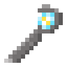 | **Cajado de Raios** Raio com faíscas que salta entre inimigos. | 17 | 2.0/s | **Tempestade** (10s): 7 raios caem sobre os inimigos. | ¢1800 | Nv 12 + raid *Floresta Sombria* |
| 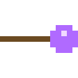 | **Cajado Arcano** Orbes estelares que perseguem o alvo. | 30 | 2.9/s | **Escudo Arcano** (12s): 4s de invulnerabilidade. | ¢7000 | Nv 20 + raid *Cavernas Douradas* |
| 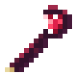 | **Cajado Sombrio** Atravessa, rouba vida e liberta almas. | 46 | 2.0/s | **Orbes Sombrios** (11s): 6s: orbes giram e bloqueiam tiros. | ¢20000 | Nv 28 + raid *Castelo Maldito* |

## Fusão

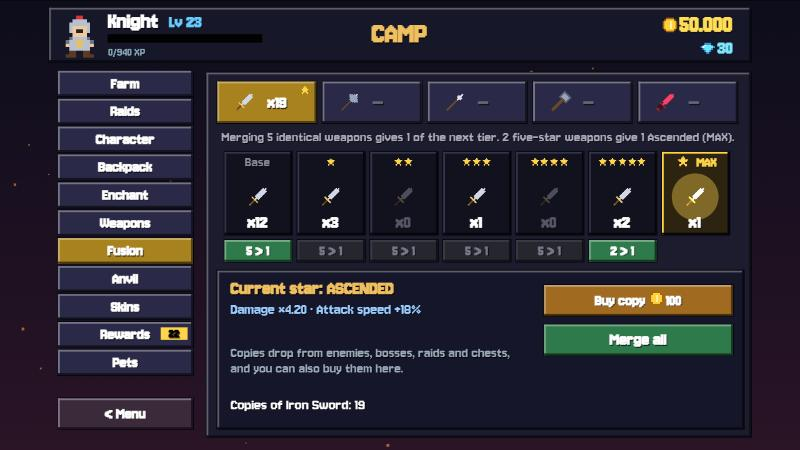 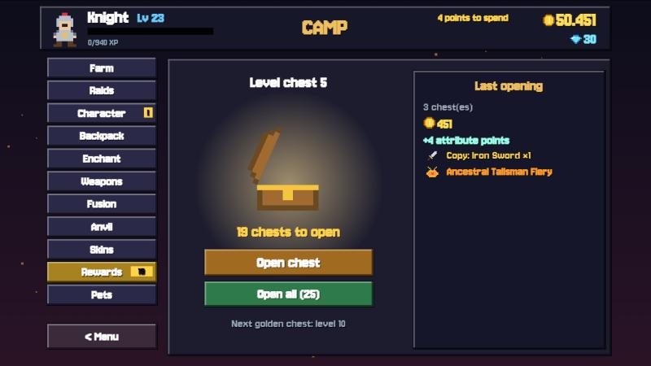

A **Fusão** desbloqueia no **nível 20** da conta e funciona para armas e para equipamento. Em ambos, **5 iguais dão 1 com uma estrela a mais**, até ao máximo de **3★**.

| Estrelas | Arma: dano | Arma: vel. de ataque | Equipamento: bónus |
|---|---|---|---|
| 1★ | ×1,40 | +3% | ×1,15 |
| 2★ | ×1,90 | +6% | ×1,30 |
| 3★ (MAX) | ×2,50 | +9% | ×1,50 |

- **Armas:** as cópias caem de inimigos, bosses, raids e baús, ou compram-se no ecrã *Fusão* (de 1, 5 ou 10 de cada vez). Juntam-se 5 cópias base para 1★, 5 de 1★ para 2★ e 5 de 2★ para 3★.
- **Equipamento:** juntam-se 5 peças iguais da Mochila (mesma peça, raridade e estrelas). Fica a peça com melhor refinamento. As peças equipadas não contam.

### Efeitos das estrelas nas habilidades (`E`)

As armas também mudam de aspeto: **1★** brilho suave, **2★** novo desenho (contorno, gema e punho dourado) com cintilação, **3★** desenho radiante, maior, com contorno luminoso e aura arco-íris. Além do dano, cada estrela melhora a habilidade da arma (por exemplo, o Cajado de Fogo passa de 1 meteoro para 2, 3 e, a 3★, uma **chuva de meteoros**).

**Cavaleiro**

| Arma | 1★ | 2★ | 3★ |
|---|---|---|---|
| Espada de Ferro | 2 investidas | 3 investidas | 4 investidas |
| Machado de Guerra | 2 ondas de choque | 3 ondas de choque | 4 ondas de choque |
| Lança do Caçador | 3 lanças em leque | 5 lanças em leque | 7 lanças em leque |
| Martelo do Trovão | 6 raios | 8 raios | 12 raios |
| Lâmina Vampírica | 8s de duração | 10s de duração | 12s de duração |

**Arqueiro**

| Arma | 1★ | 2★ | 3★ |
|---|---|---|---|
| Arco Curto | 10 flechas | 14 flechas | 20 flechas |
| Arco Triplo | 15 flechas no leque | 19 flechas no leque | 23 flechas no leque |
| Besta Pesada | 2 virotes | 3 virotes | 5 virotes |
| Arco Ígneo | explosão maior | 2 flechas de fogo | 3 flechas, explosão enorme |
| Arco Sombrio | 2 armadilhas | 3 armadilhas | 5 armadilhas |

**Mago**

| Arma | 1★ | 2★ | 3★ |
|---|---|---|---|
| Cajado de Fogo | 2 meteoros | 3 meteoros | CHUVA DE METEOROS |
| Cajado de Gelo | área maior | área e gelo maiores | nova gigante (5s de gelo) |
| Cajado de Raios | 10 raios | 14 raios | 20 raios |
| Cajado Arcano | escudo de 5s | escudo de 6s | escudo de 8s |
| Cajado Sombrio | orbes durante 8s | orbes durante 10s | orbes durante 13s |

## Equipamento

Quatro peças que caem dos inimigos e dos bosses (nos bosses e nas raids a raridade é melhor). Guardam-se na **Mochila** (30 lugares) e equipam-se no ecrã **Personagem**.

| Peça | Comum | Raro | Épico | Lendário | Mítico |
|---|---|---|---|---|---|
| **Capacete** |  Capuz de Couro |  Elmo de Ferro | 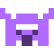 Elmo Rúnico |  Coroa Ancestral | 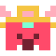 Coroa Divina |
| **Armadura** |  Túnica Simples |  Peitoral de Aço |  Armadura Rúnica |  Armadura Ancestral |  Armadura Divina |
| **Botas** | 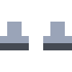 Sapatos Gastos |  Botas de Couro | 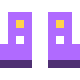 Botas Rúnicas |  Botas Ancestrais | 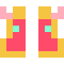 Botas Divinas |
| **Amuleto** |  Amuleto de Osso |  Colar de Prata | 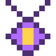 Talismã Rúnico | 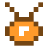 Talismã Ancestral | 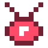 Talismã Divino |

- **Atributo principal:** Capacete e Armadura dão *Vida*, Botas dão *Velocidade*, Amuleto dá *Dano*.
- **Raridade:** cada nível de raridade acrescenta mais um bónus aleatório (Mítico tem 4). Lendário e Mítico podem trazer um **efeito especial**.
- **Venda:** itens que não queiras podem ser vendidos por ouro (há botão para vender todos os Comuns).
- **Nível do item:** sobe com a zona, a onda e também com o **teu nível**, por isso o equipamento acompanha a tua evolução. Lendário e Mítico são raros (cerca de 1% e 0,1% no início, até ~7% e ~2,5% nas raids mais difíceis).
- **Atalho no Personagem:** passa o rato por um slot para veres os itens da mochila para esse slot (com setas melhor/pior) e usa **Shift + clique** no slot para equipar o melhor.
- **Melhor ou pior?** Na Mochila, cada item mostra **MELHOR / PIOR / SIMILAR** em relação ao equipado, com a diferença de cada atributo. Na loja de armas vês a diferença de dano total face à arma equipada.

| Bónus possível | Descrição |
|---|---|
| Vida | valor fixo |
| Dano | percentagem |
| Velocidade | percentagem |
| Vel. de ataque | percentagem |
| Crítico | percentagem |
| Roubo de vida | percentagem |
| Redução de dano | percentagem |
| Ouro extra | percentagem |
| XP extra | percentagem |
| Chance de queimar | só em efeitos especiais |
| Chance de abrandar | só em efeitos especiais |

## Encantamentos e Bigorna

**Encantar (equipamento)** — ecrã *Encantar*:

- **Refinar** até +10: cada nível dá **+8%** a todos os bónus da peça. Chances de sucesso: +1: 100% · +2: 90% · +3: 80% · +4: 70% · +5: 60% · +6: 50% · +7: 40% · +8: 30% · +9: 22% · +10: 15%. A partir de +6, uma falha pode fazer a peça descer um nível.
- **Encantar especial:** sorteia um efeito (Ígneo, Gélido, Vampírico, Letal, Próspero, Sábio, Protetor, Poderoso). Podes voltar a sortear, com custo crescente.

**Bigorna (armas)** — melhora uma arma até **+12** (+12% de dano por nível, na arma e na habilidade). Podes usar o *Amuleto da Sorte* (+15% de chance, só quando a chance for inferior a 85%) e o *Pergaminho de Proteção* (a partir de +5). Falhas seguidas dão bónus de azar.

Chances base: +1: 100% · +2: 95% · +3: 90% · +4: 80% · +5: 70% · +6: 60% · +7: 50% · +8: 40% · +9: 30% · +10: 22% · +11: 15% · +12: 10%. Marcos: **+5** brilho, **+10** faíscas, **+12** aura lendária.

## Equilíbrio

O jogo foi afinado com um simulador (um bot que joga o Farm) para a dificuldade subir de forma gradual:

- Cada arma é claramente mais forte do que a anterior, e o dano de cada classe está compensado (o **Cavaleiro** tem mais dano e **15% menos dano recebido**; o **Mago** compensa o alcance e a área com menos dano).
- Os inimigos ganham vida por onda, por zona e com o teu nível; as zonas e os bosses sobem de dificuldade de forma suave, sem saltos bruscos.
- A cada 10 ondas vem uma **horda**.

## Progressão

- **Nível infinito.** Ganhas XP ao matar inimigos e bosses (mais nas raids difíceis). O ouro máximo é **999.999**.
- Cada nível dá **+4 de vida**, **+1% de dano** e **3 pontos de atributo**.
- Podes redistribuir os pontos por ouro (50 × o teu nível). Mantém o botão **+** premido para gastar pontos mais depressa.
- **Desbloqueios:** **Raids** no nível 10, **Encantar** e **Bigorna** no nível 15, **Fusão** no nível 20 e **Pets** no nível 30; as armas mais fortes pedem nível (e raids). O que está bloqueado aparece com um cadeado grande, a descrição, os níveis em falta e, ao desbloquear, há uma animação.
- **Inimigos:** ficam mais fortes com o teu nível (vida e dano), para o desafio acompanhar a tua evolução.

| Atributo | Efeito por ponto |
|---|---|
| Vitalidade | +14 vida |
| Força | +2% dano |
| Agilidade | +1.2% velocidade |
| Perícia | +1.2% velocidade de ataque |

## Farm e Raids

- **Farm:** ondas infinitas numa zona à escolha. Há um boss a cada 5 ondas e uma **horda** a cada 10 (muito mais monstros ao mesmo tempo, mais mortes para completar, mais ouro e um item no fim). Os inimigos ficam mais fortes (e dão mais ouro) a cada onda, aparecem mais depressa e em maior número, e cada zona seguinte abre quando chegas a uma onda mínima na anterior (10, 10, 20, 20 e 30). Podes sair a qualquer momento pelo menu de pausa e guardar tudo; se morreres, ficas com metade do ouro e do XP e com os itens.
- **Raids:** combates contra bosses com 4 ondas antes. São **muito difíceis** e dão muito ouro, XP e itens garantidos. Cada raid abre ao vencer a anterior, e cada dificuldade ao vencer a anterior nessa raid.

| Dificuldade | Vida | Dano | Ouro |
|---|---|---|---|
| **Fácil** | ×2 | ×1.4 | ×2 |
| **Normal** | ×3 | ×1.8 | ×4 |
| **Difícil** | ×4.5 | ×2.4 | ×8 |
| **Pesadelo** | ×7 | ×3.2 | ×16 |
| **Inferno** | ×11 | ×4.5 | ×30 |

> A velocidade do jogo pode ser posta a **x2** nos ecrãs de Farm e Raids, na pausa ou com a tecla `G`.

## Mapas

| Zona | Mapa | Nível rec. (Farm) | Boss |
|---|---|---|---|
| **Floresta Sombria** Limpa a floresta e enfrenta o Ceifador. | 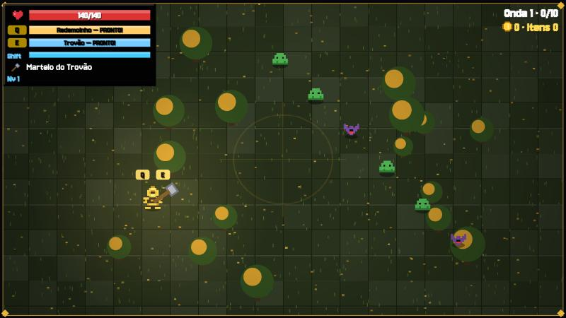 | 1 | O Ceifador |
| **Cavernas Douradas** Esqueletos e lobos guardam o Golem. | 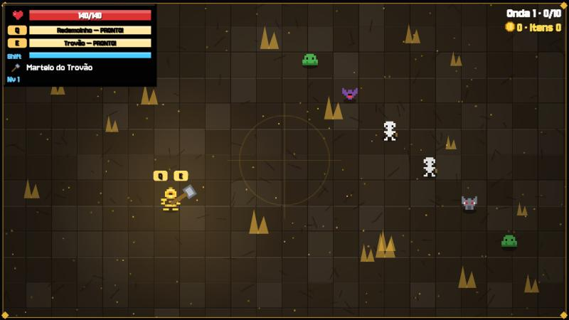 | 7 | Golem de Pedra |
| **Castelo Maldito** O covil do Dragão Rubro. | 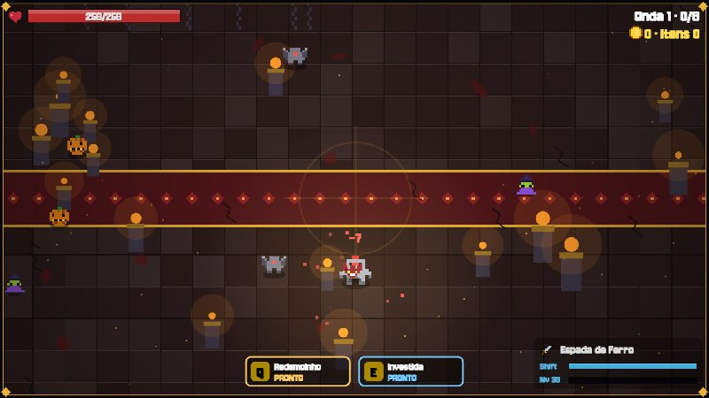 | 13 | Dragão Rubro |
| **Pântano Tóxico** Fantasmas e lobos servem a Rainha. | 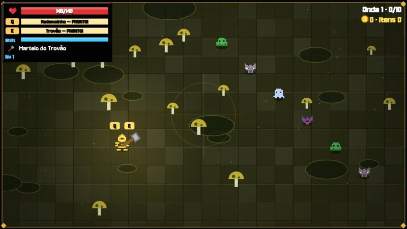 | 19 | Rainha do Pântano |
| **Deserto Ardente** O Faraó desperta das areias. | 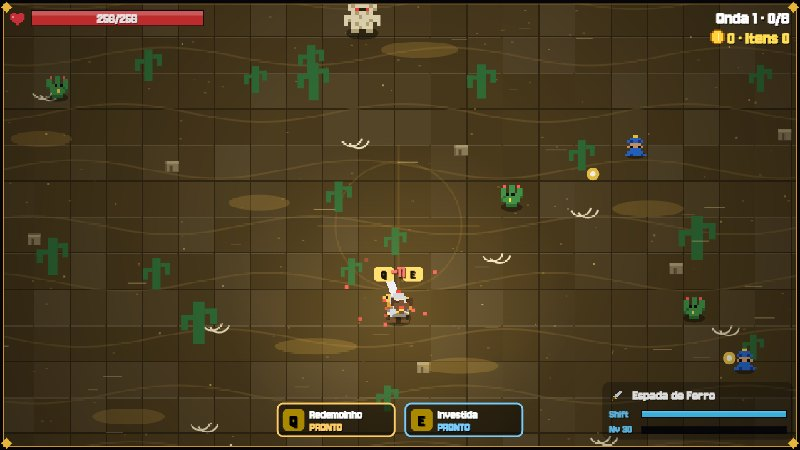 | 25 | Faraó Eterno |
| **Abismo Final** O Rei Demónio espera no fundo. | 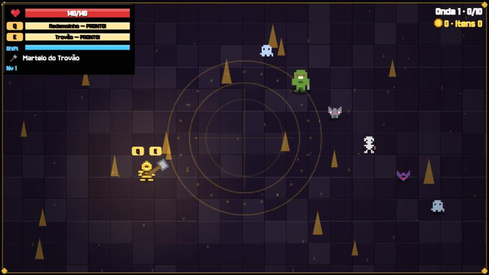 | 31 | Rei Demónio |

## Inimigos e bosses

### Inimigos

| | Inimigo | Comportamento | Vida base | Ouro |
|---|---|---|---|---|
|  | **Slime** | persegue | 3 | ¢3 |
| 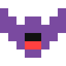 | **Morcego** | voo errático, rápido | 2 | ¢4 |
|  | **Esqueleto arqueiro** | mantém distância e dispara | 4 | ¢6 |
|  | **Bruto** | lento, muita vida e muito dano | 10 | ¢12 |
|  | **Lobo** | muito rápido | 3 | ¢5 |
|  | **Fantasma** | mantém distância e dispara orbes | 4 | ¢7 |
|  | **Diabrete** | atira bolas de fogo rápidas | 5 | ¢8 |
| 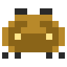 | **Escaravelho** | prepara-se (!) e investe em linha reta | 9 | ¢14 |
|  | **Cogumelo** | explode ao morrer, deixando uma área tóxica | 8 | ¢9 |

### Bosses

| | Boss | Zona | Ataques |
|---|---|---|---|
| 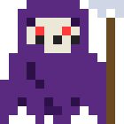 | **O Ceifador** | Floresta Sombria | anel de projéteis, investida, leque de tiros |
| 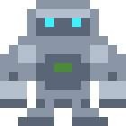 | **Golem de Pedra** | Cavernas Douradas | pancada em área, anel de projéteis, investida |
| 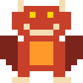 | **Dragão Rubro** | Castelo Maldito | sopro em cone, chuva de meteoros, investida |
| 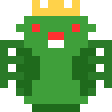 | **Rainha do Pântano** | Pântano Tóxico | leque de tiros, invoca lacaios, espiral de tiros, investida |
| 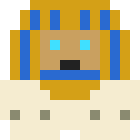 | **Faraó Eterno** | Deserto Ardente | chuva de meteoros, espiral de tiros, pancada em área, sopro em cone |
| 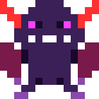 | **Rei Demónio** | Abismo Final | teletransporte, espiral de tiros, chuva de meteoros, investida, invoca lacaios, pancada em área |

A meio da vida os bosses ficam furiosos (atacam mais depressa e invocam lacaios).

## Skins

Cosméticos que mudam o aspeto do herói. A skin inicial é grátis, a 1.ª extra custa **¢5.000** e as restantes custam **diamantes ◆** (20, 40 e 60).

**Cavaleiro**

|  |  |  |  |  |
|---|---|---|---|---|
|  Clássico | 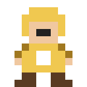 Paladino Dourado | 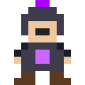 Cavaleiro Sombrio | 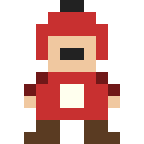 Lorde Carmesim | 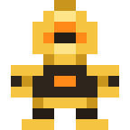 Guardião Dourado |

**Arqueiro**

|  |  |  |  |
|---|---|---|---|
|  Clássico |  Caçador da Neve | 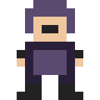 Sombra | 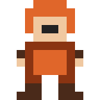 Ranger Ígneo |

**Mago**

|  |  |  |  |
|---|---|---|---|
|  Clássico |  Piromante |  Criomante |  Feiticeiro da Noite |

## Recompensas e diamantes

- **Baús por nível:** cada nível dá um baú no ecrã *Recompensas*, com ouro, pontos de atributo, equipamento e, às vezes, cópias de armas ou diamantes. De 10 em 10 níveis o baú é **dourado** (muito mais ouro, +3 pontos, item Épico ou melhor e cópia garantida).
- **Diamantes ◆:** ganhas **+10 a cada 10 níveis** e gastas nas skins.
- **Pets:** ecrã já presente, mas marcado como *Ainda por vir*.

## Ranking online

O separador **Ranking** tem classificações de **nível, mobs mortos, ouro ganho, bosses, raids** e **recorde de waves por mapa**. A conta só precisa de **nick + palavra-passe** (a palavra-passe nunca sai do teu dispositivo), o **perfil público** de cada jogador (classe, arma, atributos e equipamento) e o **save guardado na conta**: podes jogar noutro dispositivo e, ao terminar sessão, o save local é apagado. Precisa de um pequeno servidor Supabase: vê o [guia de configuração](docs/ONLINE.md).

---

Feito com carinho em HTML, CSS e JavaScript puros (canvas). Sem dependências.
